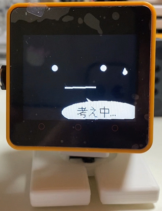
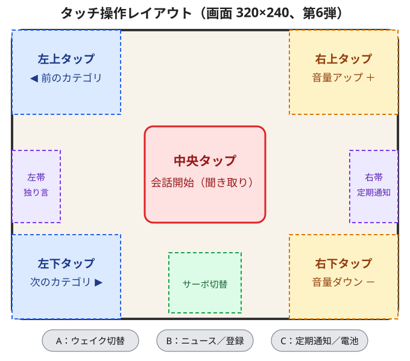

# AI_StackChan2（Akr カスタム版）

AIｽﾀｯｸﾁｬﾝ2です。
<br><br>

<br><br>

robo8080 さんの AI_StackChan2 をフォークし、M5Stack Core2 向けにカスタムした版です。

## いまの姿と操作（カスタム版 第7弾）

顔は「きなこ」の画像（写真）を全面表示します。下の図はその表示イメージをイラストで再現したものです（写真データはファームウェアに埋め込み済み）。


タッチとボタンの割り当てはこの図のとおりです。



| 操作 | 動作 |
|---|---|
| 画面中央タップ | 会話開始（聞き取り→ChatGPT→読み上げ） |
| 右上／右下タップ | 音量アップ／ダウン（6段階・レベル0は無音、吹き出しにゲージ表示、本体に保存） |
| 左上／左下タップ | ニュースのカテゴリ選択（トピックス／AI／芸能／テック／その他、約2.5秒後に読み上げ） |
| センターボタン BtnB 短押し | 今日のニュース＋AIニュースを読み上げ |
| 右ボタン BtnC 短押し | 定期通知モード ON/OFF（ONで即1回＋5分おきにニュース） |
| 右ボタン BtnC 長押し（2秒） | バッテリー残量の読み上げ |
| Bボタン長押し（2秒） | ウェイクワード登録（例：「こむぎ」と発声）／Aボタンで有効・無効切替 |
| 声「ニュース」 | ニュース読み上げ |
| ブラウザ `/voice` `/model` `/news` | 声・話速・モデルの変更、ニュース実行（本体表示IPまたは stack-chan.local） |
| ブラウザ `/schedule` | スケジュール（モーニング／時報）と側面LEDの ON/OFF 設定 |
| 側面LED（M5GOベース） | 待機＝暖色の呼吸点滅、聞き取り＝青、応答待ち＝紫、発話/ニュース＝色付き明滅、定期通知ON＝オレンジ |

## 動作確認の状況

| バージョン | 内容 | 状況 |
|---|---|---|
| 素の版（commit `d0dc6e1`） | フォーク直後のコード | ✅ 実機確認済み（2026-10-27、Core2 本体のみ） |
| カスタム版 第1弾 | ペンギン顔＋声切り替え＋モデル切り替え＋応答高速化 | ✅ 実機確認済み（2026-10-27） |
| カスタム版 第2弾 | 話速調整＋ニュース読み上げを追加 | ⚠️ 書き込み・通常動作は確認済み（2026-10-29）。ただし**ニュース取得が無音になる不具合**を確認（吹き出しは出るが取得処理が正常終了しない） |
| カスタム版 第3弾 | ニュース取得の改修（Googleニュースへ自動切替＋AIニュース追加）＋センターボタン短押しでニュース | ⚠️ **ビルド済み・実機動作は未確認**（2026-10-29 時点） |
| カスタム版 第4弾 | ニュース読み上げ中に内容を吹き出しへ順次表示 | ⚠️ **ビルド済み・実機動作は未確認**（2026-10-30 時点） |
| カスタム版 第5弾 | 顔を「きなこ」の画像（写真）に差し替え | ⚠️ **ビルド済み・実機動作は未確認**（2026-10-31 時点） |
| カスタム版 第6弾 | 音量タッチ操作（5段階）＋ニュースのカテゴリ選択＋定期通知モード（BtnC、5分おき） | ⚠️ **ビルド済み・実機動作は未確認**（2026-10-31 時点） |
| カスタム版 第7弾 | スケジューラ（毎朝7時モーニング＋時報、AI_StackChan_Exから移植）＋側面LED活用（M5GOベース、状態表示） | ⚠️ **ビルド済み・実機動作は未確認**（2026-10-31 時点） |
| カスタム版 第8弾 | 応答速度と安定性の改善（文単位パイプラインTTS、全HTTPタイムアウト、Wi-Fi自動再接続）＋音量6段階化＋字幕2行表示＋ニュース中断 | ⚠️ **ビルド済み・実機動作は未確認**（2026-10-31 時点） |
| カスタム版 第9弾 | ポーズ画像12種の顔切り替え＋ダンス動画再生（起動時と「踊って」の声かけ、モーションJPEG内蔵） | ❌ **実機で不具合**（2026-10-31）：起動時の動画再生で panic し再起動ループ。第9.1弾で修正 |
| カスタム版 第9.1弾 | 第9弾の修正：ダンス動画の軽量化（10fps・約0.66MB）と再生の安全化（フレーム検証・ヒープ確認・再生位置の移設）、ブートループ防止ガード | ❌ **実機で不具合**（2026-10-31）：動画完走直後に描画タスクのスタック破壊で panic。第9.2弾で修正 |
| カスタム版 第9.2弾 | 第9.1弾の修正：ポーズ画像のデコードを描画タスク外へ移設、描画タスクのスタック増量（2KB→8KB、ライブラリ同梱化）、ガード延長、APIキーの平文シリアル出力の除去 | ❌ **実機で不具合**（2026-10-31）：描画まわりの競合で mutex assert が発生。第9.3弾で修正 |
| カスタム版 第9.3弾（現在の main） | 第9.2弾の修正：画面まわりの操作全体を共通の再帰ロックで直列化、ダンス再生で描画タスクを停止しない方式に変更 | ⚠️ **ビルド済み・実機動作は未確認**（2026-10-31 時点） |

- 第1弾の成果物：firmware.bin 2,244,496 バイト / SHA-256 `d197a829d2b524e6fd4b85621ee87a3383605e6588f1099b8b6b1a7dad833877`
- 第2弾の成果物：firmware.bin 2,249,984 バイト / SHA-256 `792759f2a1a2399439a52488f08033ea01083edf86060f97e90df5c9d91b1e40`
- 第3弾の成果物：firmware.bin 2,253,344 バイト / SHA-256 `362ab6cea289956020ab9fa392283b7a930876c130d40eaf100ecef89c3bb2b5`
- 第4弾の成果物：firmware.bin 2,255,696 バイト / SHA-256 `9a46e64c13cf6f8a106c7a31f8f92540c7eed41bd61ecfac4f550398afd0a894`
- 第5弾の成果物：firmware.bin 2,269,280 バイト / SHA-256 `3205abb04873a5d059e9548bb1917e86ef152f5698cf22d7165923f3f3785c16`
- 第6弾の成果物：firmware.bin 2,273,392 バイト / SHA-256 `8292e7179af4a096defa45c46f503abc8283d706c302da3ee86eb9f1f234d374`
- 第7弾の成果物：firmware.bin 2,297,552 バイト / SHA-256 `2897fe9bd18be56c3d9ef23fe207d877f7cef2da3fba0b0a3c1edbfb2feeebef`
- 第8弾の成果物：firmware.bin 2,305,104 バイト / SHA-256 `599da0136319e774417d1a160ebfeca7cfd675dfab2c339de9c0607d514d4172`
- 第9弾の成果物：firmware.bin 3,565,056 バイト / SHA-256 `af402884eaa324675ba6c258558a74094122e96e27fc75f053e0c40b5a7698af`
- 第9.1弾の成果物：firmware.bin 3,064,176 バイト / SHA-256 `b47eb8fedab918478e8270250587df48563b254465086326fb2496ec62e3ed63`
- 第9.2弾の成果物：firmware.bin 3,064,512 バイト / SHA-256 `9ec8883c55edffa965f2220f56059dc17cbe96f079094769b4aaca423b87586e`
- 第9.3弾の成果物：firmware.bin 3,064,960 バイト / SHA-256 `087e11bfdec49957b991bcddf8ffb1733b4f4c6199e6e5479c38418f9d052f40`

## カスタム版で追加・変更したこと

- **きなこの顔（写真）**（`src/KinakoFace.h`＋`src/kinako_img.h`、第5弾〜）：顔を「きなこ」の画像（320×240 JPEG埋め込み）に差し替え。写真表示のため Avatar を16bitカラーで初期化。まばたき・口パクのアニメーションは無くなりますが、吹き出しやハート等のエフェクトは画像の上に表示されます。第1弾〜第4弾の顔は自作ペンギン描画（`src/PenguinFace.h`、白い顔パッチ＋黒い丸目＋クチバシ）でした
- **声の切り替えページ `/voice`**：VOICEVOX の話者14種（ずんだもん3種、四国めたん2種、春日部つむぎ、雨晴はう、波音リツ、冥鳴ひまり、九州そら、もち子さん、玄野武宏、青山龍星、剣崎雌雄）を名前で選択・試聴できます。選んだ声は本体（NVS）に保存され、再起動後も維持されます
- **話速の調整**：同じ `/voice` ページで 1.0／1.1／1.2／1.3 倍を選べます（初期値 1.2 倍）。再生側で速くする方式のため、倍率に応じて声が少し高くなります。本体に保存されます
- **AIモデルの切り替えページ `/model`**：gpt-4o-mini（初期設定）／gpt-4.1-mini／gpt-4o／gpt-3.5-turbo から選べます。本体に保存されます
- **応答の高速化**：録音は話し終わると無音検出で自動終了（固定時間まで待たない）。ChatGPT の回答は最大150トークンに制限（ロール側で指定がある場合はそちら優先）
- **ニュース読み上げ**：「ニュース」という言葉を含む発話、または**センターボタン（BtnB）の短押し**で読み上げます。一般ニュースは NHK RSS（見出し3件＋短い説明）を優先し、取得できなければ Google ニュースの見出しに自動で切り替えます。続いて AI ニュース（Google ニュースの AI 検索から見出し2件）も読み上げます。ブラウザの `/news` からも実行でき、応答末尾の `[diag]` に各取得先の HTTP コードが出るので切り分けに使えます。読み上げ中は内容が吹き出しに順次表示されます（吹き出しは1行表示のため、画面幅に収まる長さに区切って切り替え。表示は時間ベースで、読み上げと完全には同期しません）
- **音量のタッチ操作**（第6弾〜、第8弾で6段階化）：画面右上タップで音量アップ、右下タップで音量ダウン（レベル0〜5の6段階、レベル0は無音、吹き出しにゲージ表示、本体に保存）
- **応答速度の改善**（第8弾〜）：VOICEVOX 合成を文単位のパイプライン化し、最初の文ができ次第すぐ発話開始（再生中に次の文を先行合成）。tts.quest への接続は再利用し、TLS ハンドシェイクの繰り返しを削減
- **安定性の改善**（第8弾〜）：全 HTTP リクエストにタイムアウトを設定（TTS合成は1文25秒でスキップ、ChatGPT 30秒、ニュース取得はストリーム読み＋締切）。Wi-Fi 切断時は自動再接続（バックオフ付き）。起動時にリセット要因と空きメモリをシリアルと画面へ出力し、会話の節目にも所要時間ログを出す
- **字幕の2行表示**（第8弾〜）：読み上げる文章を画面下部の黒帯パネルに2行で表示（顔キャンバス内で合成するためちらつきなし）。ニュースは各記事の見出しから表示し、会話応答も字幕対象
- **ニュースの中断**（第8弾〜）：ニュース読み上げ中に画面中央をタップすると即中断（定期通知・スケジューラ由来のニュースも対象）
- **ポーズ画像の顔切り替え**（第9弾〜）：きなこのポーズ画像12種を状況・表情に応じて表示（待機＝ピース、会話開始＝手振り、応答中＝笑う、ニュース＝サムズアップ、Happy＝ハート、Doubt＝驚き、Sad＝お辞儀、Sleepy＝寝る、モーニング＝走る、ウェイク検出＝ジャンプ、Angry＝両拳上げ）
- **ダンス動画再生**（第9弾〜）：ダンス動画をモーションJPEG化して内蔵。起動時（Wi-Fi設定済みの場合）に1回自動再生し、「踊って」「ダンス」と話しかけても再生。再生中はタップか物理ボタンで中断でき、側面LEDが虹色に光る
- **ニュースのカテゴリ選択**（第6弾〜）：画面左上タップで前のカテゴリ、左下タップで次のカテゴリ。カテゴリは トピックス／AIニュース／芸能ニュース／テック／その他 の5つで、一覧を表示し約2.5秒後に選んだカテゴリを読み上げます
- **定期通知モード**（第6弾〜）：本体の右ボタン（BtnC）短押しで ON/OFF。ON にすると通常ニュース（トピックス＋AI）を読み上げ、以降5分おきに読み上げます（再起動で OFF）。バッテリー残量の読み上げは BtnC 長押しに移設
- **タッチレイアウト変更**（第6弾〜）：会話開始は画面中央タップに移設。左帯タップ＝独り言切替、右帯タップ＝定期通知トグル、下部中央タップ＝サーボ切替
- **スケジューラ**（第7弾〜、`src/Scheduler.h`／`src/Scheduler.cpp`、ronron-gh/AI_StackChan_Ex から移植）：毎日／毎時／間隔／一回限りの時刻ベース実行。既定で「毎朝7時に日付＋ニュース読み上げ」と「7〜23時の毎正時に時報」が ON。発話・録音と重なるときは割り込まず、モーニングは最大5分延期・時報はスキップ。本体の時刻は Wi-Fi 接続時に NTP（JST）で同期
- **側面LED活用**（第7弾〜）：M5GO Bottom2 ベースの SK6812×10（GPIO25、FastLED）を状態表示に使用。待機は暖色の呼吸点滅（定期通知ON中はオレンジ）、聞き取り中は青、応答待ちは紫、発話中は音声レベル連動の明滅（ニュースはカテゴリ色）、音量変更時はレベル×2個を緑点灯、ウェイクワード検出時は白2回点滅。明るさは控えめ（上限 48/255）、`/schedule` から無効化も可能

## 手順

### 1. ビルド

必要なもの：VSCode＋PlatformIO（または PlatformIO Core の CLI）

```bash
cd M5Unified_AI_StackChan
pio run -e m5stack-core2
```

成果物は `.pio/build/m5stack-core2/firmware.bin` です。
環境：espressif32@6.3.2、M5Unified 0.1.16（詳細は `platformio.ini`）。

### 2. 本体への書き込み

**方法A（推奨・ブラウザで書き込み）**
書き込みページ一式が private リポジトリ `2ndarystorage/stackchan-core2` の `ai_stackchan_flasher/` フォルダにあります。

1. そのリポジトリを ZIP でダウンロードして解凍する
2. 解凍したフォルダ内の `ai_stackchan_flasher` で `python3 -m http.server 8000 --bind 127.0.0.1` を実行する
3. Chrome で `http://localhost:8000` を開く
4. Core2 を USB で接続し、ページの案内に従ってシリアルポートを選んで書き込む

書き込み内容：bootloader（0x1000）／パーティション（0x8000）／NVS初期化（0x9000）／boot_app0（0xe000）／アプリ本体（0x10000）／SPIFFS初期化（0xc90000）。
※ NVS と SPIFFS が初期化されるため、書き込み後は WiFi・APIキー・ウェイクワードの再設定が必要です。

**方法B（esptool で直接）**
上記のオフセットに各バイナリ（bootloader.bin / partitions.bin / boot_app0.bin / firmware.bin）を書き込んでください。

**元に戻したい場合**
公式コミュニティ版 stack-chan v2.0.1 は公式 Web インストーラ（https://stack-chan.github.io/stack-chan/web/flash/）から書き直せます。

### 3. 初期設定（WiFi / APIキー）

microSD カードのルートに2つのファイルを作って入れる方法が確実です。

- `wifi.txt`：1行目に SSID、2行目にパスワード
- `apikey.txt`：1行目に OpenAI キー、2行目に VOICEVOX キー（tts.quest）、3行目に STT キー（Whisper を使う場合は OpenAI キーと同じもの）

カードを入れて電源を入れ直すと接続され、画面に IP アドレスが表示されます。
WiFi 未設定のまま起動すると「Waiting for SmartConfig」を表示して再起動を繰り返します（故障ではありません）。

### 4. 使い方

- **ウェイクワードの登録**（最初の1回だけ）：本体の **Bボタン（下段まん中）を2秒長押し** →「ウェイクワード登録開始」と表示されたら、呼び名にしたい言葉（例：「こむぎ」）を1回はっきり言う → 登録した声が再生され「登録終了」と出れば完了。ウェイクワードは文字ではなく自分の声で登録する方式です
- **会話の始め方**：**Aボタン（下段左）** を押して「ウェイクワード有効」にしてから登録した言葉で呼ぶ。または画面の「STT」表示あたりをタッチしても会話が始まります
- **ニュース**：「ニュース教えて」のように「ニュース」を含めて話しかけると、最新ニュースを読み上げます
- **電池残量**：Cボタン（下段右）で読み上げます
- **独り言モード**：放っておくと時々独り言を言います。Bボタン長押し（ウェイクワード登録）をすると止まります

### 5. ブラウザ設定ページ一覧

本体と同じ WiFi から `http://stack-chan.local`（開けない場合は本体表示の IP アドレス）で開けます。

| ページ | 内容 |
|---|---|
| `/voice` | 声（話者14種）の切り替え・試聴、話速（1.0〜1.3倍）の切り替え |
| `/model` | AIモデルの切り替え |
| `/news` | ニュース読み上げをその場で実行 |
| `/speech?say=文章` | 任意の文章を喋らせる（`&voice=話者ID` で一時的に声変更可） |
| `/face?expression=0〜5` | 表情変更（0:Neutral 1:Happy 2:Sleepy 3:Doubt 4:Sad 5:Angry） |
| `/setting?volume=&led=&speaker=` | 音量・LED・話者IDの直接設定 |
| `/apikey` `/role` | APIキー設定／ロール（キャラ設定）編集 |

### 顔と表情について

- 顔は M5Stack-Avatar ライブラリが描画しています（画像ファイルではありません）。カスタム版の顔は `src/PenguinFace.h` です
- 表情ごとにエフェクトが出ます：Happy=ハート（右上）、Angry=怒りマーク、Doubt=汗、Sad=チルマーク、Sleepy=鼻ちょうちん
- ハートは主に「発話中」「会話開始時（『御用でしょうか？』）」に表示されます
- サーボを使う場合の GPIO は `main.cpp` で設定（現在のビルドは Core2 PORT A：X=GPIO33 / Y=GPIO32）。サーボ未接続でも動作します

---

AIｽﾀｯｸﾁｬﾝ2の特徴<br>

* 音声合成にWeb版 VOICEVOXを使います。
* 音声認識に"Google Cloud STT"か"OpenAI Whisper"のどちらかを選択できます。
<br>

Google Cloud STTは、”MhageGH”さんの [esp32_CloudSpeech](https://github.com/MhageGH/esp32_CloudSpeech/ "Title") を参考にさせて頂きました。ありがとうございました。<br>
"OpenAI Whisper"が使えるようにするにあたって、多大なご助言を頂いた”イナバ”さん、”kobatan”さんに感謝致します。<br>
ウェイクワードには、”MechaUma”さんの[SimpleVox](https://github.com/MechaUma/SimpleVox/ "Title")ライブラリを使わせていただきました。

---

### M5GoBottom版ｽﾀｯｸﾁｬﾝ本体を作るのに必要な物、及び作り方 ###
こちらを参照してください。<br>
* [ｽﾀｯｸﾁｬﾝ M5GoBottom版組み立てキット](https://raspberrypi.mongonta.com/about-products-stackchan-m5gobottom-version/ "Title")

### プログラムをビルドするのに必要な物 ###
* [M5Stack Core2](http://www.m5stack.com/)
* VSCode
* PlatformIO

使用しているライブラリ等は"platformio.ini"を参照してください。

### 使い方（オリジナル版） ###

* [AI_StackChan2_README](https://github.com/robo8080/AI_StackChan2_README/ "Title")
<br>

---

## Program Summary
* M5Stack-based “AI Stack-chan” that records audio, runs speech-to-text (Google Cloud STT or OpenAI Whisper), sends chat to OpenAI, and speaks responses via VOICEVOX TTS.
* Includes on-device avatar/face animation, optional servo movement, wake-word handling, and a small HTTP server for settings (API keys, role, speech/face controls).
* Stores configuration in NVS/SPIFFS and can load Wi-Fi/API keys from SD card files.
* This fork adds: a penguin face, web pages for voice/speech-rate/model selection, faster responses (silence-based recording stop, max_tokens cap), and NHK news headline reading triggered by the word 「ニュース」.

## Completion Status
Stock code verified on real hardware (M5Stack Core2) on 2026-10-27. Custom v1 (penguin face, /voice, /model, speedups) also verified on device the same day. Custom v2 (speech-rate control, news reading) is built but **not yet verified on the device**.
