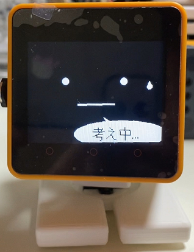
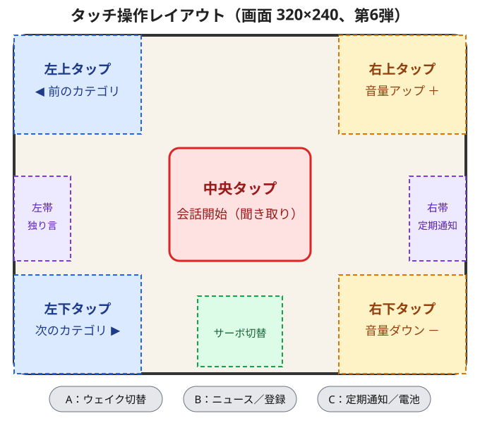

## v9.26 実機不具合修正版（2026-11-07）

v9.25 の実機初回セッションで確認された不具合2件と、起動時ログの小掃除を行いました。

**修正1: ウォッチドッグ・リセット（TG1WDT_SYS_RESET／reset reason INT_WDT）**

実機ログの経過：起動直後のダンス自動再生はヒープ不足（free 51,752）でガードが正しく見送り。その後のニュース取得（Google RSS、開始時 free 51,432／largest 49,140）で既読・旧記事のスキップが続いた後、`[Google RSS] headlines:` の完了行が出ないままリセットしました。再起動後は free heap 197,344 まで回復し、再発はログ範囲内では無し。

根本原因の最有力候補は、**既読ストアの SPIFFS 保存が RSS ストリーム走査の最中に走っていた**ことです。従来、`newsAcceptArticle()` が記事を採用するたびに `newsSeenAdd()` → `newsSeenSave()` が SPIFFS へ全件書き戻しをしていました。ESP32 のフラッシュ書き込み・消去は、実行中は他コアをキャッシュ無効化で割り込み禁止のまま止めるため、消去が長引く（セクタ消去のワーストケースや SPIFFS の GC 連鎖）と割り込みウォッチドッグ（TG1、300ms）を踏み得ます。完了行が出ず、panic 出力もないハードリセットである点と整合します（単一ログからの断定はできないため、下記のとおり「止まらない構造」への変更と、再発時に箇所を特定できる仕組みを併せて入れました）。

- **保存の後段一括化**：`newsSeenAdd()` はメモリ上の記録とダーティーフラグだけ更新し、SPIFFS への書き戻しは取得完了後（TLS を閉じた後）に `newsSeenFlush()` が1回だけ行います（`exec_news`／`exec_news_category`／Function Calling の `get_news` の各出口。加えて loop のアイドル時にダーティーが残っていれば保存する保険付き）。書き込み回数は1回の読み上げあたり最大5回程度→1回に減ります。
- **取得ループの分割と yield**：Google 見出し走査は約1KB ごと、NHK 本文読みは約4KB ごとに `delay(1)` を挟み、データが流れ続ける場合でも loop を独占しないようにしました（従来はデータがある間 delay なしで回り続けていました）。
- **低ヒープ時の安全弁**：`exec_news` の2本目（AIニュース）の TLS ハンドシェイクは、free heap 45,000 以上かつ最大連続ブロック 40,000 以上のときだけ行い、不足時は `[News] AI feed skipped: low heap` を出して一般ニュースだけで読み上げます（閾値は実測の動作点 largest=49,140 に余裕を持たせた値）。
- **起動時ダンス自動再生の見直し**：発火条件を「起動3秒後・Wi-Fi接続」から「穏やかな瞬間」に変更しました。起動10秒以降、ヒープ 80KB 以上（自動再生専用の下限。再生自体のガード 60KB は不変）、発話・合成なし、TLS ゲート空き、メニュー／ダイアログなし、が揃うまで最大120秒待ち、揃わなければ自動再生だけ見送ります（音声トリガーの再生は従来どおり）。先送り・見送りは `[DANCE] boot autoplay deferred/skipped` で理由つきで出ます。
- **パンくずログ**：loop の主要区間の入口で現在区間名を記録し（`news-nhk`／`news-google`／`news`／`news-cat`／`chat`／`chat-tools`／`stt`／`dance`／`mem-extract`／`spiffs-seen`／`loop`）、loop が15秒ごとに `[HB] t=<ms> heap=<free> largest=<最大連続> crumb=<区間> mode=<m> seen_dirty=<0/1>` を出力します。再発時はリセット直前の `[HB]` の `crumb` が最後にいた区間、`heap`／`largest` が逼迫度を示します。

v9.24 のモード分離、v9.25 の Function Calling／長期記憶、TLS の規律（TlsGate 等）は変更していません。

**修正2: ニュースカテゴリメニューのチラつき**

左上タップで開くカテゴリ一覧は、loop から `M5.Lcd` へ直接描画していたため、顔の合成キャンバス（スプライト）の毎フレーム転写に上書きされて点滅していました（第9.23弾で直した版数バッジと同じ病型）。設定ダイアログ（第9.19弾）と同じく、**一覧を顔合成キャンバス内（KinakoFace.h の描画最終段）へ描く**よう移設しました。位置・並び（画面左側に6カテゴリ縦並び・選択行に ▶）は従来どおりで、タップでの選択送り・約2.5秒で確定・中央タップでキャンセル等の操作挙動は変えていません。

**小掃除: 起動時の data.json 読み込み**

本体保存の `/data.json`（チャット設定）が未保存・空の場合でも、毎回 `Failed to deserialize JSON` と設定 JSON のダンプが出ていました。ファイル不在・空ファイルは正常系（設定未保存）として扱い、警告もダンプも出しません。中身があるのに解釈できない場合だけ `[BOOT] data.json: parse failed (<理由>); using defaults` を1行出します。保存済み設定がある場合の読み込み・反映の挙動は従来どおりです。

Core2ビルド成功・既存回帰27件成功。ファーム 3,605,680 bytes、SHA-256 `eb448cf1f9a8941add5aec5a87d73339b7e1c11f70eb1dde16cc40f1d42e9461`。**実機での動作は未確認**です（リセット再発の有無、[HB] の出力、メニューのちらつき解消、起動時ダンスの先送り挙動は本体で要確認）。配布（書き込みページ）は本版 v9.26 に更新しました（今回は vendor/ フォルダも同梱）。

## v9.25 Function Calling＋長期記憶メモリ版（2026-11-07）

会話 AI（ChatGPT）に Function Calling のツールを持たせ、声で実作業ができるようにしました。あわせて、会話から「覚えるべきこと」を抽出して本体に保存する長期記憶メモリを追加しました。**版数について**：このブランチでは v9.24 を「通常動作とBLE転送のモード分離（開発版）」が使用済みのため、本機能は **v9.25** としました。v9.25 は v9.24（モード分離）を含む、v9.23 の次の配布版です。

**Function Calling**: 会話経路（音声 `exec_chatGPT` と HTTP `/chat` の共通位置）に tools を追加し、tool_calls の実行→結果返却→再リクエストのループ（往復最大3回）を実装しました。使えるツールは次の6つです。

| ツール | 内容 |
| --- | --- |
| `set_timer` | 単発タイマー。`minutes`（何分後・相対）と `time`（HH:MM・絶対）の排他指定、発火時に読み上げる `message` 必須。同時4件まで |
| `get_weather` | v9.20 の天気取得を再利用（`day_offset` 0=今日／1=明日／2=明後日／7=週間要約） |
| `get_train_delays` | v9.21 の運行情報取得を再利用（田園都市線・大井町線・南武線） |
| `get_news` | 既存ニュース取得を再利用（48時間鮮度フィルタ・既読スキップ込み、見出し＋説明を返す） |
| `get_current_datetime` | JST の現在日時・曜日 |
| `remember_fact` | 長期記憶への即時保存（下記と共通の保存処理） |

- タイマーは Scheduler 基盤へ単発タスク（`ScheduleTimerOnce`）として登録します。発火判定は loop 側でも行うため、**相対タイマーは NTP 未同期でも発火**します（Scheduler の `run_schedule()` は時刻未同期時に早期 return するため）。絶対指定は現在時刻が同期済みのときだけ受け付け、過ぎた時刻は翌日に回します。発火時は既存の発話キューに載せ、発話中なら終わるまで待ち（上限10分、超えたら破棄してログ）、中央タップで中断もできます。再起動するとタイマーは消えます。
- フォールバック：tools 付きリクエストが API エラー（400等）を返したら tools なしで1回だけ再試行し、通常会話として成立させます（モデルは /model の選択どおり変えません）。引数 JSON が壊れていたらエラーをモデルへ1回だけ返し、2回目で会話を壊さず「うまくできませんでした」と発話します。ログは `[FC]` 接頭辞（関数名と成否のみ、引数の個人情報は出しません）。
- 既存のキーワード分岐（天気・電車・ニュース）は速い経路として従来どおりチャットの前に処理され、変更していません。複合リクエスト（「明日の天気と電車の遅れを教えて」）や言い換えは AI 経由のツールで処理されます。
- 天気・運行情報は、読み上げ文の生成部を `buildWeatherText()` / `buildTrainText()` に分離してツールと共用しました（発話へのセットは従来のラッパーが担当し、挙動は不変）。

**長期記憶メモリ**:

- 保存先は **microSD の `/memory_facts.txt` 優先、なければ SPIFFS**（/digest/ と同じ選択方式で、初回アクセス時に決まります）。1行＝1件の短い事実文（UTF-8）、上限 **40件・約4KB**、超過時は古い順に削除します。
- 会話への反映：`init_chat_doc` の直後に、保存済みの事実一覧を「ユーザーについて覚えていること」としてシステムプロンプトへ追加します（0件なら追加しません）。
- 自動抽出：音声会話の応答を話し終わった後、loop のアイドル時間（発話・合成・BLE がなく Wi-Fi 接続済みのとき）に1回だけ抽出 API を呼びます。入力は直近のやり取り＋現在の事実一覧、出力は更新後の事実一覧の JSON 配列だけを厳密に返させ、検証（配列・文字列のみ・件数・総バイト数）を通った場合のみファイルへ書き戻します。失敗は `[MEM]` ログのみで会話に影響しません。抽出は会話に使っているモデル（/model の選択）を使い、HTTPS は CheckedTlsClient / TlsGate の規律に従います。
- 明示保存：「覚えて：〜」に応える `remember_fact` ツールで即時保存し、保存した旨が返答に含まれます。
- 管理ページ：本体 Web の `GET /memory`（一覧＋追加フォーム＋件ごとの削除）、テスト用 `GET /memory_json`。本体ホームからもリンクしています。外部公開はしません（従来ページと同条件）。
- **書き込み（フルフラッシュ）で SPIFFS は初期化されますが、SD 側の `/memory_facts.txt` は消えません。** 記憶を残したい場合は SD カードを入れて使ってください（保存先は /memory ページで確認できます）。

Core2ビルド成功・既存回帰27件成功。ファーム 3,604,880 bytes、SHA-256 `3ff3b456f046c814b63c4353c70890ec22792ff5cacc4a06040bfa44d0895cc5`。**実機での動作は未確認**です（ツール呼び出しの実応答、タイマー発火、抽出の成否、ヒープ推移は本体で要確認）。配布（書き込みページ）は本版 v9.25 に更新しました。

## v9.24 開発版: 通常動作とBLE転送を分離

通常モードとBLE転送専用モードを、設定・起動経路ごと分離しました。**モード切替は再起動方式**で、通常時はBluetooth予約メモリを解放、BLE時はWi-Fi・TLS・音声・Avatar・スケジューラを起動しません。v9.24を書き込んだ後は、本体Webの `/mode` から切替できます。既存のWi-Fi・APIキー・音量設定と、次回BLE指定のNVS名前空間は別です。

**Core2ビルド・回帰27件成功。実機書き込みとv9.24動作確認は未実施、配布ファームはv9.23のままです。** 起動待ち15秒、受信待ち3分、保存後15秒・時間切れ・Cボタンで通常へ戻る回復経路も追加しました。既存のTLS確保失敗・BLE無応答の実機解消はまだ断定できません。配布照合は異なる版のため `firmware.bin differs from build` で失敗しています。詳細・警告・操作・未確認事項は [v9.24モード分離と検証記録](docs/MODES_V924.md) を参照してください。

以下はv9.23以前の履歴です。旧 `GET /ble` 即時開始手順はv9.24では表示専用に変わります。

## v9.23 BLEテキスト転送・転送ニュース版（2026-11-02）

**実機追加試験で要修正を確認:** 最新配布v9.23を書き込み、バージョン表示のちらつき改善はユーザー確認済みです。一方、起動後の低メモリ、TLS確保失敗、BLE開始後のWeb無応答を確認したため、ユーザー指定で元のv9.21へ復元しました。復元後はダンス完走・TLS成功・元のミュート設定を確認。v9.23を全機能の動作確認済みとは扱いません。[実機試験・復旧結果](docs/DEVICE_TEST_V923.md)、[VOICEVOXキーの取得と設定上の注意](docs/VOICEVOX_API_KEY.md)。配布ファームは変更せず、定期タスクも削除済みのままです。

両リポジトリのリモート更新と手元の検証記録を、ユーザー承認のもと履歴を残して取り込みました。Core2ビルド・更新後の回帰20件・配布の版整合試験は成功。取り込み時点では実機未試験で、その後の追加試験結果は上記のとおりです。**既存配布v9.23とローカル再ビルドはサイズ／ハッシュが不一致**で、ユーザー指定により既存配布を保持しています。ビルド環境の埋め込みパス等に差が見つかりましたが、完全な再現一致は未達です。[取り込み・試験の初期失敗と修正・差分調査](docs/INTEGRATION_V923.md)。v9.18の可聴確認をv9.23の成功へ読み替えません。

Muse／ChatGPT／Codex が検索・要約したテキスト（ITニュース、GitHub ランキング、Hugging Face ランキング等）を BLE で本体へ転送して保存し、ニュースとして読み上げる機能を追加しました。BLE スタックは NimBLE（h2zero/NimBLE-Arduino 1.4.3、ペリフェラル専用にセントラル／オブザーバ・ロールを無効化）を使います。

受信はオンデマンド方式です。BLE は常時 ON にせず、`GET /ble` で受信モードを開始したときだけ ON になります（書き込みページの「テキスト転送」欄からも開始できます）。受信待ちは3分間で、画面には吹き出しで「BLE受信待ち」と出ます。転送完了（保存後15秒）またはタイムアウトで自動的に OFF に戻ります（`NimBLEDevice::deinit` でスタックごと解放）。開始・終了時は `[BLE]` ログにヒープ残量を出します。音声の再生・合成・発話待ちがある間は受信モードを開始しません（`/ble` は 409 を返します）。受信モード中は定期読み上げ・朝のスケジューラ・中央タップ会話を開始せず、転送と競合しないようにしています。

GATT 設計（128bit カスタム UUID）：サービス `e8f5a001-b7d3-4c1e-9a2b-3d4c5e6f7081`、CTRL `e8f5a002-…`（Write：`BEGIN:<総バイト数>`／`END`／`ABORT`）、DATA `e8f5a003-…`（Write、1書き込み最大180バイト、応答あり）、STATUS `e8f5a004-…`（Read／Notify：`WAIT`／`RECV n/m`／`DONE <ファイル名>`／`ERR …`）。デバイス名は `StackChan-Digest`、MTU は 185 を要求します。受信データは PSRAM 上の一時バッファに組み立て、`END` 時に総バイト数を検証してから正式保存します。途中切断時は部分データを破棄して受信待ちに戻ります。

保存先は microSD の `/digest/` を優先し、カードが使えない場合は SPIFFS にフォールバックします（キャプチャと同じ優先順位）。形式はプレーンテキスト UTF-8（1行目＝タイトル、以降＝本文）で、ファイル名は `dg_NNNN.txt`、保持は最新10件（古い順に削除）、1件の上限は 60KB です。

読み上げへの組み込み：ニュースのカテゴリに「転送ニュース」（6番目、LED 色は紫）を追加し、選ぶと最新の保存テキストを読み上げます。本文は改行位置で文を区切り、既存の文分割パイプライン（speech_text＋2行字幕＋中央タップ中断可）で読み上げます。定期読み上げと朝のスケジューラ読み上げでは、未読の転送テキストがあれば最新の1件をニュースの後に続けて読み上げ、既読にします（繰り返し読まない）。既読は最新の読み終えた連番を NVS（setting/dgread）に保持し、ニュースの既読記録と同様に書き込みでリセットされます。テスト用に `GET /digest`（最新の転送テキストを読み上げ開始）も追加しました。書き込みページの「テキスト転送」欄では、タイトル＋本文を入力し、「BLEで送信」ボタンで Web Bluetooth 接続して CTRL→DATA（180バイト刻み）→END の順に送り、STATUS で保存結果を確認します。

IRAM 対策について：BT コントローラ（prebuilt の libbtdm_app.a）が約28KB の IRAM を占有し、そのままでは iram0_0_seg（128KB）が超過してリンクできませんでした。コントローラ側は変更できないため、追加リンカスクリプト `move_time_to_flash.ld` で、タスク文脈からしか呼ばれない libc の時刻系オブジェクト（strftime／strptime／mktime／gmtime 系／tzset 系、合計約9KB）だけを IRAM からフラッシュへ移しています（ISR やフラッシュ書込みのクリティカル区間からは呼ばれない純粋な文字列・時刻計算処理です）。あわせて platformio.ini に NimBLE のロール無効化フラグを追加しています。

あわせて実機報告のあった不具合2件を修正しました。(1) 左上の版数バッジの点滅：バッジは顔の描画後にパネルへ直接描かれており、次のフレームで顔の合成キャンバスが転写されるたびに消され、再描画との繰り返しで点滅して見えていました。バッテリー／音量 HUD と同じく、顔合成のキャンバス内（Face::draw の最終段、GfxLock の内側）へ描くよう変更しました（同梱 Avatar ライブラリ側の変更として VENDORED.md にも記録）。(2) LED 輝度設定の反映：設定→NVS 保存→変数→FastLED.setBrightness() の経路は生きていましたが、ledTask が「ピクセルフレームが変化したときだけ FastLED.show() する」実装だったため、静止フレーム（聞き取り中の青一色・音量ゲージ等）では輝度変更が LED に出力されませんでした。輝度の変化も show() の条件に加え、変更が次の表示で即時反映されるようにしました。あわせて、低輝度側の段階の刻みが 1/255 単位で見分けられなかったため、段階値を {0,1,2,4,6,12} に見直しました（既定レベル4=6・上限12は従来どおり、NVS 保存・再起動後の保持も従来どおり）。全 LED パターンに効く全体輝度である点は変わりません。

Core2ビルドは成功。ただし追加の実機試験では、ちらつき改善を確認した一方でTLS確保失敗・BLE開始後のWeb無応答を検出しました。**BLE通信・保存・読み上げを動作確認済みとは扱いません**。ユーザー指定で本体は元のv9.21へ復元しています。MTU交渉・データ書き込み・SD／SPIFFS保存・未読処理・カテゴリ読み上げ・LED輝度は引き続き要確認です。既存配布ファームは3,535,568 bytes、SHA-256 `4ed098e399b63b0330dfcfc4e6d09df4083ae5ac2d1905aeb6367a27e9b97646`のまま保持。mainは未変更です。

## v9.22 天気のチャンク転送対応版（2026-11-01）

第9.20弾の天気予報が実機で「天気予報を取得できませんでした」になる不具合を修正しました。Open-Meteo は応答を Transfer-Encoding: chunked で返しますが、天気取得は HTTPClient の生ストリームをそのまま読み込んでいたため、本文の先頭にチャンクサイズ行などのフレーミング（実測で本文638バイトに対し合計650バイト、+12バイト）が混ざり、JSON のパースが先頭で失敗していました（ニュース・電車は本文を走査する方式のため影響なし）。本文の読み取りを、TTS ダウンロードや電車の走査と同じ作法のチャンクデコード付きリーダ（`src/HttpBody.h` の ChunkReader）へ差し替え、ヘッダで chunked / Content-Length を判定して両形式を読めるようにしました。あわせて、パース失敗時には ArduinoJson のエラー内容と本文の先頭をログへ出すよう診断を強化しています。デコード処理はホスト側でも検証済みで、チャンク形式に包んだ実応答サンプルから元の JSON がバイト単位で復元され、パースと読み上げ文の組み立てまで通ることを確認しています。

Core2ビルドは成功。**実機での動作は未確認**です（`/weather` で `[Weather] JSON parse failed` が出ず、予報が読み上げられることを本体で要確認）。ファーム 3,317,648 bytes、SHA-256 `1c0722397a400bac6526e3e5cd5b15bda60bb6b077562dfcbb4d33e0b64e7582`。mainは未変更です。

## v9.21 電車の運行情報版（2026-11-01）

電車の運行情報の音声回答を追加しました。「電車の遅れはある？」「遅延情報を教えて」のように話しかけると、ChatGPT を経由せず、本体が日テレ気象・防災サイトの関東エリア鉄道情報（bosai.news.ntv.co.jp）から直接取得して読み上げます。対象は **東急田園都市線・東急大井町線・JR南武線** の3路線です。同ページは「現在運行情報のある路線」だけを会社名・路線名・状態つきで列挙する形式のため、対象路線が載っていなければ平常と判断し、「田園都市線、大井町線、南武線に遅れはありません」と答えます。異常がある路線は「田園都市線は運転を見合わせています」「南武線は列車に遅れが出ています」のように路線ごとに読み上げます（状態は 運転見合わせ／運転計画／ダイヤ乱れ／列車遅延／運転再開 を判別し、同路線に複数あれば最も重いものを採用）。読み上げ文は画面の2行字幕にも表示し、中央タップで中断できます。テスト用に `GET /train`（対象3路線の運行情報を読み上げ開始）も追加しました。意図判定は「遅延」「遅れ」「運行」「電車」を含む発話で、天気・ニュースの判定とは競合しない順序にしています。

取得元の選定について：無料で安定した公式APIは存在しません。かつて広く使われた RTI技研の delay.json は提供元の解散によりサーバーが停止していたため不採用とし、キー不要で3路線すべてをカバーし更新も頻繁な日テレ防災を採用しました（2026-11-01 に実データで会社名・路線名・状態の記載形式を確認）。ページ全体は保持せず、直近バイト列だけを残すストリーミング走査で路線名と直後の状態語を探します（chunked 転送のデコードつき、走査上限1MB・25秒）。TLS は SSL Labs で実チェーンを確認し（グレードA+、配信は Vercel、信頼パスは ISRG Root X1 に終端）、ISRG Root X1 + X2（自己署名）をピン留めしています（`src/rootCAtrain.h`）。

Core2ビルドは成功。**実機での動作は未確認**です（TLS接続可否、ページ走査の一致、読み上げは本体で要確認。特に、Vercel 配信のため本体からの取得がブロックされる場合は User-Agent 等の調整が別途必要になる可能性があります）。ファーム 3,316,240 bytes、SHA-256 `381a675959c793b170f2d2ac55aa622e3fa1f16bca31ce72cd5fb8ac6c9ce347`。mainは未変更です。

## v9.20 天気予報・ニュース鮮度対策版（2026-11-01）

天気予報の音声回答を追加しました。「明日の天気は？」のように話しかけると、ChatGPT を経由せず、本体が Open-Meteo（無料・APIキー不要）から東京の予報を直接取得して読み上げます。「今日」「明日」「明後日」で対象日を切り替え、指定がなければ明日、「週間」で7日分の要約（日付・曜日・天気・最高/最低気温）を読み上げます。読み上げ文は天気・最高/最低気温・降水確率で構成し、画面の2行字幕にも表示します。テスト用に `GET /weather`（明日の予報を読み上げ開始）も追加しました。TLS は SSL Labs で実チェーンを確認し、ISRG Root X1 + X2（自己署名）をピン留めしています（`src/rootCAopenmeteo.h`）。

あわせて、古い台風ニュースを繰り返し読み上げる不具合を修正しました（本修正は第9.20弾に同梱）。ニュース取得時に各記事の pubDate を確認し、48時間より古い記事を読み上げ対象から外します（日付が取れない記事は除外しません）。さらに読み上げ済み記事のタイトルハッシュを SPIFFS（`/news_seen.txt`）に記録して次回以降はスキップします（保持は最大60件・5日で自動掃除）。NHK／Google の両経路に適用しています。すべて古い/既読で新しい記事がない場合、手動（声・ボタン・`/news`）では「新しいニュースはありません」と短く読み上げ、定期通知・スケジューラの自動読み上げでは無言でスキップします（モーニング読み上げは日付の挨拶のみになります）。

Core2ビルドは成功。**実機での動作は未確認**です（天気の取得・読み上げ、ニュース鮮度/重複フィルタの効き方は本体で要確認）。ファーム 3,307,680 bytes、SHA-256 `c1e53257811a6d624b66b8cd3b41df458bf2f9753af083de641e4cdc6ade87aa`。mainは未変更です。

## v9.19 画面消灯・設定ダイアログ・画面キャプチャ版（2026-11-01）

5分間無操作で画面を自動消灯します（発話中・ダンス再生中は消灯しません。消灯中はスケジュール発話の開始でも点灯）。復帰はタッチ／物理ボタンで、その最初の入力は復帰専用に消費され他の機能は動きません。画面中央のダブルタップでも即消灯します（シングルタップ＝会話開始の発火はダブル判定のため最大300ms遅れます）。

従来の右上＝音量アップ／右下＝音量ダウンのタッチ割り当てを廃止し、右上タップで設定ダイアログ（上段＝音量、下段＝LED輝度、現在値と操作案内つき）を開く形に変更しました。ダイアログ表示中は右上＝音量+／左上＝音量-／右下＝LED輝度+／左下＝LED輝度-、中央タップで閉じ、5秒無操作でも自動で閉じます。側面LED（M5GO Bottom2）の輝度は6段階で、既定レベル4＝従来の固定上限6と同じ明るさ、変更は即時反映され NVS（setting/ledlevel）に保存されます。音量は従来どおり6段階・NVS保存です。

表示の修正として、白い吹き出し（Avatar のスピーチバルーン）が画面下部の2行字幕と重なっていた問題も直しました。吹き出しの中心を cy=220 → 170 へ 50px 上げて下端が字幕パネル（y196〜240）の上端に揃うようにし、吹き出し内の文字サイズも 2 → 1.5（0.75倍、efontJA_16 で約32px → 約24px相当）に小さくしました（字幕側のフォントは変更なし。同梱 Avatar ライブラリ側の変更として VENDORED.md にも記録）。

画面キャプチャも追加しました。本体右ボタン BtnC のダブルタップで、その時点の画面を LCD から読み出して 24bit BMP（320×240）で保存します（短押し＝定期通知トグルの発火はダブル判定のため最大300ms遅れます。成功時はトーンと吹き出し、失敗時は吹き出しで通知）。保存先は microSD の `/shots/` を優先し、カードが使えない場合は SPIFFS にフォールバック（保持上限は SD 100枚／SPIFFS 3枚、超過時は古い順に削除）。本体 HTTP に一覧 `GET /shots`・ダウンロード `GET /shot?name=`・削除 `GET|POST /shotdel?name=`（いずれも CORS ヘッダ付き、ファイル名は shot_NNNN.bmp 形式のみ許可）を追加し、書き込みページからも一覧・ダウンロード・削除ができます。

Core2ビルドは成功。**実機での動作は未確認**です（消灯/復帰、ダイアログ操作、キャプチャの読み出しと保存先、HTTP 連携は本体で要確認）。ファーム 3,293,360 bytes、SHA-256 `4e8b5f64f6e291aed782c9e9a14bcbfdd0cdf866f71cbf7175dc68e51f5df0d0`。mainは未変更です。

## v9.18 TLSメモリ修正版（2026-11-01）

追加依頼の他カテゴリニュース・ウェイクワード試験は接続復旧待ちです。従来のUSB機器が見つからず、従来IPのWeb診断もタイムアウトしました。ウェイクワードは登録済み音声とBtnAでの有効化が必要で、登録時のI2S復帰などソース上の要修正箇所も確認しています。[検証状況・確認手順・未確認事項](docs/NEWS_WAKEWORD_V918.md)。

正しいサーバー証明書と製品CAでも、内部RAM不足が`-9984 / flags=0x08`になる経路をMbed TLS 2.28.1で再現しました。4KiB以上のTLS割当をPSRAM優先へ変更し、同じ内部RAM制限で20回連続検証成功。誤CA／ホスト名は拒否したままです。証明書の無効化や盲目的な差し替えはしていません。

ビルド・回帰20件・4ホストの制限RAM TLS接続・配布照合に成功。ユーザー許可のもと、実機のアプリ領域だけへv9.18を書き込み、ハッシュ照合・起動・ダンス100フレーム完走を確認しました。設定領域は未消去です。実機TLS接続3回と状態取得10回に成功した後、**ニュース1回・全5チャンクが全量読み出し・自然終了、失敗チャンク0・出力エラー0・TLS確保失敗0**となりました。ユーザーからも2音のテスト音、ニュースの声と滑らかな再生を確認いただきました。追加依頼でテスト音2音を再実行し、最新の再実行分もユーザー確認済みです。

**残る問題:** サービスから`isApiKeyValid: NG`と429が出て、今回は有限再試行で復帰しましたが、合成待ち・文間の待ちは残ります。再生中のWeb診断は既存のHTTP処理停止条件によりタイムアウトします。連続HTTP要求時の接続切断も未解決です。長時間・別条件を含む全不具合の解消とは断定しません。[根拠・実機検証・制限](docs/TLS_MEMORY_V918.md)、[数値記録](docs/DEVICE_TEST_V918.json)を参照してください。大きいTLSバッファは平文の一時通信データを含めPSRAMへ置かれるため、外部RAMの物理観測に対する保証はありません。

同じWi-Fiの`/audio`に**TLS接続テスト（HTTP・API要求なし）**を追加しました。v9.18の実機で、CA／ホスト名検証とメモリ失敗を、音出し・合成・APIキー送信なしで確認できます。v9.17のスピーカー修正は維持。mainは未変更です。

## v9.17 スピーカー出力・音量修正版（2026-11-01）

今回のログはv9.15でした。全量デコードされても音が出たとは限らず、出力アダプターのbegin無条件成功と低音量の二重減衰を修正しました。内蔵スピーカーを明示し、稼働状態とPCM送信数・ピーク・ミュートを確認します。左上はv9.17です。

同じWi-Fiの`http://stack-chan.local/audio`（または本体IPの`/audio`）で、キー不要・API不要の2音テストと状態確認ができます。テストはミュート中も一時的に中程度の音量で鳴らし、終了後に元へ戻します。会話中は実行しません。信頼するLAN内だけで使用してください。フラッシャーにも版不一致拒否と旧キャッシュ対策を追加しました。

Core2ビルド・Pythonテスト17件・Node版整合試験・配布照合は成功。**実機の無音解消は未確認**で、TLS X509/BIGNUMとキーNG/429も別途未解決です。[原因・検証記録・手順](docs/SPEAKER_OUTPUT_V917.md)。この環境から本体名の解決はタイムアウトしたため、実機音量／音出しは確認していません。mainは未変更です。

## v9.16 左上バージョン表示・I2S修正・TLS診断（2026-11-01）

画面左上に`v9.16`を表示します。顔・吹き出し・ダンスより後に共通ロック内で描画。M5Unified 0.1.16で停止後に残るスピーカーのI2Sドライバを解放してからマイクへ戻し、終端での最初のMP3 BUFLENを通常エラーと区別しました。

今回の実機ログでは2文は全量読み出し・自然終了ですが、その後のX509 -9984は未解決です。解放前の検証flags・接続先・発行者を記録し、証明書失敗を残りの全文で繰り返さず停止する処理を追加しました。検証の無効化はしていません。NG/429はキー未受理・サービス制限で、別途確認が必要です。

Core2ビルド・テスト14件＋C++音声試験・PC上Mbed TLS 2.28.1の4ホスト接続と誤CA拒否・配布照合は成功。**実機での新表示・I2S修正とX509の解消は未確認**です。[原因・補助環境構築時の失敗を含む検証記録・残作業](docs/DIAGNOSTICS_V916.md)。ファーム3,274,400 bytes、SHA-256 `ce05c03c32c6c0c6645c66c5ddf6c5ed3722c028e403294787112e137d4235b8`。mainは未更新です。USBなし診断は未実装です。

## v9.15 音声取得・TLS処理修正版（2026-11-01）

合成は成功しても音声取得でX509エラーになり、ストリーム再生への切替でTLSが二重化してメモリ不足になる問題を修正しました。リクエストごとの接続再生成・TLS共通ロック・完成音声待ち・メモリ再生限定・中断の処理中フラグ保持を実装。TTSのRoot YRとGoogleのGTS Root R4も追加しています。TLS検証は維持し、日本語URLエンコードの範囲外参照も修正しました。

Core2ビルド、Pythonテスト10件とC++音声回帰試験、4ホストのPC上TLS 1.2接続、配布全パーツ照合が成功。再梱包前の不一致検出・旧版拒否の試験も記録しています。**実機での再生成功と、断続的なTTS X509失敗の解消は未確認**です。生成完了待ちは1文最大90秒（進行中HTTPは別途タイムアウト）、先読み待ちは最大20秒です。

[原因・修正・検証と書き込み手順](docs/TTS_TRANSPORT_V915.md)。ファーム3,271,024 bytes、SHA-256 `d1ebe70bec4546c7340033b31444ccb8329f2b298d00fc008aac7e8caa63fbc0`。配布・ソースとも`codex/news-audio-v912`を継続し、mainは未更新です。起動マーカーは`TTS CA: ISRG Root X1 + Root YR (v9.15)`です。**v9.14だけでは今回の実機症状は解決しませんでした。**

## v9.14 TTS証明書修正版（2026-11-01）

TTS接続に使う期限切れのクロス署名証明書を、公式のISRG Root X1自己署名版へ更新しました。証明書／ホスト名検証は維持。PC上のTLS 1.2接続検証、Core2ビルド、Pythonテスト6件とC++音声回帰テストは成功しました。**本体への書き込み・実機での音声再生は未実施**です。

[原因・証明書・検証記録](docs/TTS_CA_V914.md)。ファームは3,268,912 bytes、SHA-256 `20c263741056bf9d2dc8ab98463d3848395da6c494b08be3640ad01240b552a8`。起動ログの `TTS CA: ISRG Root X1 self-signed (v9.14)` で識別します。v9.13の起動ロック修正とニュース音声修正も維持しています。

## v9.13 起動クラッシュ修正版（2026-11-01）

**v9.12には起動ダンス時のクラッシュがあるため、v9.13を使ってください。** 同梱のロック修正済みAvatarがビルドに選ばれず、ダンスと顔描画がSPI上で競合していたことを、報告ログと一致するELFで特定しました。同梱版を明示指定し、未修正版ではコンパイル／リンクできないチェックを追加しました。表情変更も共通ロックで直列化します。音声専用タスク等の修正は維持しています。

Core2ビルド、描画競合・版チェック・音声回帰テスト、実際のELFのロック呼び出し確認が成功。**実機の起動確認は未実施**です。[原因と検証記録](docs/BOOT_CRASH_V913.md)。ファームSHA-256: `639c3963ff59e064ab959b7916a74c560dfafbeefda83f52bf1b2d6a46b5281f`。

# AI_StackChan2（Akr カスタム版）

AIｽﾀｯｸﾁｬﾝ2です。
<br><br>

<br><br>

robo8080 さんの AI_StackChan2 をフォークし、M5Stack Core2 向けにカスタムした版です。

## いまの姿と操作（カスタム版 第7弾）

顔は「きなこ」の画像（写真）を全面表示します。下の図はその表示イメージをイラストで再現したものです（写真データはファームウェアに埋め込み済み）。


タッチとボタンの割り当てはこの図のとおりです。



| 操作 | 動作 |
|---|---|
| 画面中央タップ | 会話開始（聞き取り→ChatGPT→読み上げ）。ダブルタップで画面消灯（第9.19弾） |
| 右上タップ | 設定ダイアログを開く（第9.19弾：表示中は四隅タップで音量とLED輝度を調整。従来の右上／右下タップ＝音量アップ／ダウンは廃止） |
| 左上／左下タップ | ニュースのカテゴリ選択（トピックス／AI／芸能／テック／その他、約2.5秒後に読み上げ） |
| センターボタン BtnB 短押し | 今日のニュース＋AIニュースを読み上げ |
| 右ボタン BtnC 短押し | 定期通知モード ON/OFF（ONで即1回＋5分おきにニュース） |
| 右ボタン BtnC ダブルタップ | 画面キャプチャを BMP（320×240）で保存（第9.19弾、microSD の /shots/ 優先、無ければ SPIFFS） |
| 右ボタン BtnC 長押し（2秒） | バッテリー残量の読み上げ |
| Bボタン長押し（2秒） | ウェイクワード登録（例：「こむぎ」と発声）／Aボタンで有効・無効切替 |
| 声「ニュース」 | ニュース読み上げ |
| ブラウザ `/voice` `/model` `/news` | 声・話速・モデルの変更、ニュース実行（本体表示IPまたは stack-chan.local） |
| ブラウザ `/schedule` | スケジュール（モーニング／時報）と側面LEDの ON/OFF 設定 |
| 側面LED（M5GOベース） | 待機＝暖色の呼吸点滅、聞き取り＝青、応答待ち＝紫、発話/ニュース＝色付き明滅、定期通知ON＝オレンジ |

## 動作確認の状況

| バージョン | 内容 | 状況 |
|---|---|---|
| 素の版（commit `d0dc6e1`） | フォーク直後のコード | ✅ 実機確認済み（2026-10-27、Core2 本体のみ） |
| カスタム版 第1弾 | ペンギン顔＋声切り替え＋モデル切り替え＋応答高速化 | ✅ 実機確認済み（2026-10-27） |
| カスタム版 第2弾 | 話速調整＋ニュース読み上げを追加 | ⚠️ 書き込み・通常動作は確認済み（2026-10-29）。ただし**ニュース取得が無音になる不具合**を確認（吹き出しは出るが取得処理が正常終了しない） |
| カスタム版 第3弾 | ニュース取得の改修（Googleニュースへ自動切替＋AIニュース追加）＋センターボタン短押しでニュース | ⚠️ **ビルド済み・実機動作は未確認**（2026-10-29 時点） |
| カスタム版 第4弾 | ニュース読み上げ中に内容を吹き出しへ順次表示 | ⚠️ **ビルド済み・実機動作は未確認**（2026-10-30 時点） |
| カスタム版 第5弾 | 顔を「きなこ」の画像（写真）に差し替え | ⚠️ **ビルド済み・実機動作は未確認**（2026-10-31 時点） |
| カスタム版 第6弾 | 音量タッチ操作（5段階）＋ニュースのカテゴリ選択＋定期通知モード（BtnC、5分おき） | ⚠️ **ビルド済み・実機動作は未確認**（2026-10-31 時点） |
| カスタム版 第7弾 | スケジューラ（毎朝7時モーニング＋時報、AI_StackChan_Exから移植）＋側面LED活用（M5GOベース、状態表示） | ⚠️ **ビルド済み・実機動作は未確認**（2026-10-31 時点） |
| カスタム版 第8弾 | 応答速度と安定性の改善（文単位パイプラインTTS、全HTTPタイムアウト、Wi-Fi自動再接続）＋音量6段階化＋字幕2行表示＋ニュース中断 | ⚠️ **ビルド済み・実機動作は未確認**（2026-10-31 時点） |
| カスタム版 第9弾 | ポーズ画像12種の顔切り替え＋ダンス動画再生（起動時と「踊って」の声かけ、モーションJPEG内蔵） | ❌ **実機で不具合**（2026-10-31）：起動時の動画再生で panic し再起動ループ。第9.1弾で修正 |
| カスタム版 第9.1弾 | 第9弾の修正：ダンス動画の軽量化（10fps・約0.66MB）と再生の安全化（フレーム検証・ヒープ確認・再生位置の移設）、ブートループ防止ガード | ❌ **実機で不具合**（2026-10-31）：動画完走直後に描画タスクのスタック破壊で panic。第9.2弾で修正 |
| カスタム版 第9.2弾 | 第9.1弾の修正：ポーズ画像のデコードを描画タスク外へ移設、描画タスクのスタック増量（2KB→8KB、ライブラリ同梱化）、ガード延長、APIキーの平文シリアル出力の除去 | ❌ **実機で不具合**（2026-10-31）：描画まわりの競合で mutex assert が発生。第9.3弾で修正 |
| カスタム版 第9.3弾 | 第9.2弾の修正：画面まわりの操作全体を共通の再帰ロックで直列化、ダンス再生で描画タスクを停止しない方式に変更 | ⚠️ **実機で一部確認**（2026-10-31）：描画系は約17分安定稼働。ただしTTS合成にクラッシュ不具合があり第9.4弾で修正 |
| カスタム版 第9.4弾 | TTSの連鎖障害の修正：合成クライアントの生成/破棄を対で行う方式に変更、429時のバックオフ再試行、長文チャンク拡大、再生バッファのPSRAM移設 | ⚠️ **ビルド済み・実機動作は未確認**（未書き込みのまま第9.5弾に統合） |
| カスタム版 第9.5弾 | 側面LEDの省電力化：明るさ上限を 48/255（約19%）から 16/255（約6%）へ変更（第9.4弾の内容を含む） | ⚠️ **ビルド済み・実機動作は未確認**（未書き込みのまま第9.6弾に統合） |
| カスタム版 第9.6弾 | ニュース無音の根本対策：音声をPSRAMへ一括ダウンロードしてからメモリ再生する方式に変更し暗号化接続を一本化、失敗時の再試行、バッテリー残量（4段階）と音量の右上常時表示、側面LED上限を16→6へ | ⚠️ **ビルド済み・実機動作は未確認**（未書き込みのまま第9.7弾に統合） |
| カスタム版 第9.7弾 | ポーズ画像12種とダンス動画の背景を黒に変更（キャラクター・ポーズ・動きは従来どおり。第9.6弾の内容を含む） | ⚠️ **実機で一部確認**（2026-10-31）：ダンス動画100フレーム完走・黒バック・表示系を確認。ただしニュース音声が細切れになる問題があり第9.8弾で修正 |
| カスタム版 第9.8弾 | ニュース音声の細切れ対策：チャンク転送の解読を正しく行いフレーミング混入を解消、ダウンロードの完全性検証、再生末尾のガード追加、MP3デコーダ作業領域のPSRAM化、接続の都度解放でヒープ回復 | ⚠️ **実機で一部確認**（2026-10-31）：細切れ対策とヒープ回復（最大連続38.9KB）を確認。ただしGoogle系取得が証明書検証エラーになる問題が判明し第9.9弾で修正 |
| カスタム版 第9.9弾 | Google系取得の証明書検証エラーを修正：埋め込みルートCAをクロスサイン版から自己署名の GTS Root R1 へ差し替え（Google STTも同時に解消） | ⚠️ **ビルド済み・実機動作は未確認**（2026-10-31 時点） |
| カスタム版 第9.10弾 | ニュース途切れの実測対策：実音声の解析でファイル健全性を確認（160kbps CBR・フレーム欠けなし）。デコーダ作業領域を起動時に内蔵ヒープへ常駐確保、先行合成を最大3文先まで＋冒頭プリバッファ、再生計測ログと音声切替マーカーを追加 | ❌ **実機で退行**（2026-10-31）：内蔵ヒープ常駐がヒープを圧迫し、全HTTPS接続がメモリ不足で失敗して音声が流れなくなった。第9.11弾で回復 |
| カスタム版 第9.11弾（現在の main） | 第9.10弾の退行の回復：デコーダ作業領域の確保先をPSRAMへ戻した（第9.10弾の計測ログ・先行キュー等は維持） | ⚠️ **ビルド済み・実機動作は未確認**（2026-10-31 時点） |

- 第1弾の成果物：firmware.bin 2,244,496 バイト / SHA-256 `d197a829d2b524e6fd4b85621ee87a3383605e6588f1099b8b6b1a7dad833877`
- 第2弾の成果物：firmware.bin 2,249,984 バイト / SHA-256 `792759f2a1a2399439a52488f08033ea01083edf86060f97e90df5c9d91b1e40`
- 第3弾の成果物：firmware.bin 2,253,344 バイト / SHA-256 `362ab6cea289956020ab9fa392283b7a930876c130d40eaf100ecef89c3bb2b5`
- 第4弾の成果物：firmware.bin 2,255,696 バイト / SHA-256 `9a46e64c13cf6f8a106c7a31f8f92540c7eed41bd61ecfac4f550398afd0a894`
- 第5弾の成果物：firmware.bin 2,269,280 バイト / SHA-256 `3205abb04873a5d059e9548bb1917e86ef152f5698cf22d7165923f3f3785c16`
- 第6弾の成果物：firmware.bin 2,273,392 バイト / SHA-256 `8292e7179af4a096defa45c46f503abc8283d706c302da3ee86eb9f1f234d374`
- 第7弾の成果物：firmware.bin 2,297,552 バイト / SHA-256 `2897fe9bd18be56c3d9ef23fe207d877f7cef2da3fba0b0a3c1edbfb2feeebef`
- 第8弾の成果物：firmware.bin 2,305,104 バイト / SHA-256 `599da0136319e774417d1a160ebfeca7cfd675dfab2c339de9c0607d514d4172`
- 第9弾の成果物：firmware.bin 3,565,056 バイト / SHA-256 `af402884eaa324675ba6c258558a74094122e96e27fc75f053e0c40b5a7698af`
- 第9.1弾の成果物：firmware.bin 3,064,176 バイト / SHA-256 `b47eb8fedab918478e8270250587df48563b254465086326fb2496ec62e3ed63`
- 第9.2弾の成果物：firmware.bin 3,064,512 バイト / SHA-256 `9ec8883c55edffa965f2220f56059dc17cbe96f079094769b4aaca423b87586e`
- 第9.3弾の成果物：firmware.bin 3,064,960 バイト / SHA-256 `087e11bfdec49957b991bcddf8ffb1733b4f4c6199e6e5479c38418f9d052f40`
- 第9.4弾の成果物：firmware.bin 3,066,016 バイト / SHA-256 `e9d39e5a67445b825c78667e8c83eee91f190672ef16b515a1b5a71e7e8fa06e`
- 第9.5弾の成果物：firmware.bin 3,066,016 バイト / SHA-256 `eb0595986191ffaaffd45d6079ad19dc632d3f32a48752b1c136f240843e5dee`
- 第9.6弾の成果物：firmware.bin 3,070,480 バイト / SHA-256 `aa8969fd7c79bca0e8e099f21239b5fb49a86836d40ef118301bd3e532b5657a`
- 第9.7弾の成果物：firmware.bin 3,260,624 バイト / SHA-256 `85d64b545bafc04a27f7d8d279685d4d8e9b146a5c149818efd5d67bba2d8494`
- 第9.8弾の成果物：firmware.bin 3,262,992 バイト / SHA-256 `f6e612110e12a3ab6f3ea39c51106ee76f8f00f6c2ec9ffd3d40324898e476b1`
- 第9.9弾の成果物：firmware.bin 3,262,976 バイト / SHA-256 `e4d7b336c60f1308e705f8895f01be91fcbd481af7b642cfff61e81a7cc2fec5`
- 第9.10弾の成果物：firmware.bin 3,265,552 バイト / SHA-256 `a5b286a28779c27b1aba193270cad81b19a940c6eed339981849f0415170b714`
- 第9.11弾の成果物：firmware.bin 3,265,536 バイト / SHA-256 `aa58ac08fc9b9038e8850ec2b0d3b397443676e98aed63a9aaa681315fdf9fdd`

## ニュース音切れ対策 v9.12

2026-11-01の実機ログに対する修正版です。MP3デコードをJPEG描画・UIから分離した専用タスクへ移し、PCMキューへの投入失敗時のデータ保持と文末の排出待ちを追加しました。短い案内文も後続とまとめてTTSへ送信し、初回の先読み待ちは最大20秒に変更しています。PSRAM配置は維持しています。

`consumed=0` はclose後に位置が0へ戻る計測上の問題もあったため修正し、`max_decode_gap` を追加しました。`isApiKeyValid: NG` と429はサービス側でキーを受理せずリクエストが制限されているため、`/apikey` のVOICEVOXキーも確認してください。ソフト修正だけでAPIの制限は解消できません。

詳細・検証手順・未確認事項: [NEWS_AUDIO_V912.md](docs/NEWS_AUDIO_V912.md)。Core2向けビルドと回帰テストは成功。ファームは3,268,896 bytes、SHA-256 `4c7ad5b9184c08c2a213e4f938dd9289b5a81cdb156123005a39bf9b0b471f80`。実機の再生改善はまだ未確認です。

## カスタム版で追加・変更したこと

- **きなこの顔（写真）**（`src/KinakoFace.h`＋`src/kinako_img.h`、第5弾〜）：顔を「きなこ」の画像（320×240 JPEG埋め込み）に差し替え。写真表示のため Avatar を16bitカラーで初期化。まばたき・口パクのアニメーションは無くなりますが、吹き出しやハート等のエフェクトは画像の上に表示されます。第1弾〜第4弾の顔は自作ペンギン描画（`src/PenguinFace.h`、白い顔パッチ＋黒い丸目＋クチバシ）でした
- **声の切り替えページ `/voice`**：VOICEVOX の話者14種（ずんだもん3種、四国めたん2種、春日部つむぎ、雨晴はう、波音リツ、冥鳴ひまり、九州そら、もち子さん、玄野武宏、青山龍星、剣崎雌雄）を名前で選択・試聴できます。選んだ声は本体（NVS）に保存され、再起動後も維持されます
- **話速の調整**：同じ `/voice` ページで 1.0／1.1／1.2／1.3 倍を選べます（初期値 1.2 倍）。再生側で速くする方式のため、倍率に応じて声が少し高くなります。本体に保存されます
- **AIモデルの切り替えページ `/model`**：gpt-4o-mini（初期設定）／gpt-4.1-mini／gpt-4o／gpt-3.5-turbo から選べます。本体に保存されます
- **応答の高速化**：録音は話し終わると無音検出で自動終了（固定時間まで待たない）。ChatGPT の回答は最大150トークンに制限（ロール側で指定がある場合はそちら優先）
- **ニュース読み上げ**：「ニュース」という言葉を含む発話、または**センターボタン（BtnB）の短押し**で読み上げます。一般ニュースは NHK RSS（見出し3件＋短い説明）を優先し、取得できなければ Google ニュースの見出しに自動で切り替えます。続いて AI ニュース（Google ニュースの AI 検索から見出し2件）も読み上げます。ブラウザの `/news` からも実行でき、応答末尾の `[diag]` に各取得先の HTTP コードが出るので切り分けに使えます。読み上げ中は内容が吹き出しに順次表示されます（吹き出しは1行表示のため、画面幅に収まる長さに区切って切り替え。表示は時間ベースで、読み上げと完全には同期しません）
- **音量のタッチ操作**（第6弾〜、第8弾で6段階化）：画面右上タップで音量アップ、右下タップで音量ダウン（レベル0〜5の6段階、レベル0は無音、吹き出しにゲージ表示、本体に保存）
- **応答速度の改善**（第8弾〜）：VOICEVOX 合成を文単位のパイプライン化し、最初の文ができ次第すぐ発話開始（再生中に次の文を先行合成）。tts.quest への接続は再利用し、TLS ハンドシェイクの繰り返しを削減
- **安定性の改善**（第8弾〜）：全 HTTP リクエストにタイムアウトを設定（TTS合成は1文25秒でスキップ、ChatGPT 30秒、ニュース取得はストリーム読み＋締切）。Wi-Fi 切断時は自動再接続（バックオフ付き）。起動時にリセット要因と空きメモリをシリアルと画面へ出力し、会話の節目にも所要時間ログを出す
- **字幕の2行表示**（第8弾〜）：読み上げる文章を画面下部の黒帯パネルに2行で表示（顔キャンバス内で合成するためちらつきなし）。ニュースは各記事の見出しから表示し、会話応答も字幕対象
- **ニュースの中断**（第8弾〜）：ニュース読み上げ中に画面中央をタップすると即中断（定期通知・スケジューラ由来のニュースも対象）
- **ポーズ画像の顔切り替え**（第9弾〜）：きなこのポーズ画像12種を状況・表情に応じて表示（待機＝ピース、会話開始＝手振り、応答中＝笑う、ニュース＝サムズアップ、Happy＝ハート、Doubt＝驚き、Sad＝お辞儀、Sleepy＝寝る、モーニング＝走る、ウェイク検出＝ジャンプ、Angry＝両拳上げ）
- **ダンス動画再生**（第9弾〜）：ダンス動画をモーションJPEG化して内蔵。起動時（Wi-Fi設定済みの場合）に1回自動再生し、「踊って」「ダンス」と話しかけても再生。再生中はタップか物理ボタンで中断でき、側面LEDが虹色に光る
- **ニュースのカテゴリ選択**（第6弾〜）：画面左上タップで前のカテゴリ、左下タップで次のカテゴリ。カテゴリは トピックス／AIニュース／芸能ニュース／テック／その他 の5つで、一覧を表示し約2.5秒後に選んだカテゴリを読み上げます
- **定期通知モード**（第6弾〜）：本体の右ボタン（BtnC）短押しで ON/OFF。ON にすると通常ニュース（トピックス＋AI）を読み上げ、以降5分おきに読み上げます（再起動で OFF）。バッテリー残量の読み上げは BtnC 長押しに移設
- **タッチレイアウト変更**（第6弾〜）：会話開始は画面中央タップに移設。左帯タップ＝独り言切替、右帯タップ＝定期通知トグル、下部中央タップ＝サーボ切替
- **スケジューラ**（第7弾〜、`src/Scheduler.h`／`src/Scheduler.cpp`、ronron-gh/AI_StackChan_Ex から移植）：毎日／毎時／間隔／一回限りの時刻ベース実行。既定で「毎朝7時に日付＋ニュース読み上げ」と「7〜23時の毎正時に時報」が ON。発話・録音と重なるときは割り込まず、モーニングは最大5分延期・時報はスキップ。本体の時刻は Wi-Fi 接続時に NTP（JST）で同期
- **側面LED活用**（第7弾〜）：M5GO Bottom2 ベースの SK6812×10（GPIO25、FastLED）を状態表示に使用。待機は暖色の呼吸点滅（定期通知ON中はオレンジ）、聞き取り中は青、応答待ちは紫、発話中は音声レベル連動の明滅（ニュースはカテゴリ色）、音量変更時はレベル×2個を緑点灯、ウェイクワード検出時は白2回点滅。明るさは控えめ（上限 48/255）、`/schedule` から無効化も可能

## 手順

### 1. ビルド

必要なもの：VSCode＋PlatformIO（または PlatformIO Core の CLI）

```bash
cd M5Unified_AI_StackChan
pio run -e m5stack-core2
```

成果物は `.pio/build/m5stack-core2/firmware.bin` です。
環境：espressif32@6.3.2、M5Unified 0.1.16（詳細は `platformio.ini`）。

### 2. 本体への書き込み

**方法A（推奨・ブラウザで書き込み）**
書き込みページ一式が private リポジトリ `2ndarystorage/stackchan-core2` の `ai_stackchan_flasher/` フォルダにあります。

1. そのリポジトリを ZIP でダウンロードして解凍する
2. 解凍したフォルダ内の `ai_stackchan_flasher` で `python3 -m http.server 8000 --bind 127.0.0.1` を実行する
3. Chrome で `http://localhost:8000` を開く
4. Core2 を USB で接続し、ページの案内に従ってシリアルポートを選んで書き込む

書き込み内容：bootloader（0x1000）／パーティション（0x8000）／NVS初期化（0x9000）／boot_app0（0xe000）／アプリ本体（0x10000）／SPIFFS初期化（0xc90000）。
※ NVS と SPIFFS が初期化されるため、書き込み後は WiFi・APIキー・ウェイクワードの再設定が必要です。

**方法B（esptool で直接）**
上記のオフセットに各バイナリ（bootloader.bin / partitions.bin / boot_app0.bin / firmware.bin）を書き込んでください。

**元に戻したい場合**
公式コミュニティ版 stack-chan v2.0.1 は公式 Web インストーラ（https://stack-chan.github.io/stack-chan/web/flash/）から書き直せます。

### 3. 初期設定（WiFi / APIキー）

microSD カードのルートに2つのファイルを作って入れる方法が確実です。

- `wifi.txt`：1行目に SSID、2行目にパスワード
- `apikey.txt`：1行目に OpenAI キー、2行目に VOICEVOX キー（tts.quest）、3行目に STT キー（Whisper を使う場合は OpenAI キーと同じもの）

カードを入れて電源を入れ直すと接続され、画面に IP アドレスが表示されます。
WiFi 未設定のまま起動すると「Waiting for SmartConfig」を表示して再起動を繰り返します（故障ではありません）。

### 4. 使い方

- **ウェイクワードの登録**（最初の1回だけ）：本体の **Bボタン（下段まん中）を2秒長押し** →「ウェイクワード登録開始」と表示されたら、呼び名にしたい言葉（例：「こむぎ」）を1回はっきり言う → 登録した声が再生され「登録終了」と出れば完了。ウェイクワードは文字ではなく自分の声で登録する方式です
- **会話の始め方**：**Aボタン（下段左）** を押して「ウェイクワード有効」にしてから登録した言葉で呼ぶ。または画面の「STT」表示あたりをタッチしても会話が始まります
- **ニュース**：「ニュース教えて」のように「ニュース」を含めて話しかけると、最新ニュースを読み上げます
- **電池残量**：Cボタン（下段右）で読み上げます
- **独り言モード**：放っておくと時々独り言を言います。Bボタン長押し（ウェイクワード登録）をすると止まります

### 5. ブラウザ設定ページ一覧

本体と同じ WiFi から `http://stack-chan.local`（開けない場合は本体表示の IP アドレス）で開けます。

| ページ | 内容 |
|---|---|
| `/voice` | 声（話者14種）の切り替え・試聴、話速（1.0〜1.3倍）の切り替え |
| `/model` | AIモデルの切り替え |
| `/news` | ニュース読み上げをその場で実行 |
| `/speech?say=文章` | 任意の文章を喋らせる（`&voice=話者ID` で一時的に声変更可） |
| `/face?expression=0〜5` | 表情変更（0:Neutral 1:Happy 2:Sleepy 3:Doubt 4:Sad 5:Angry） |
| `/setting?volume=&led=&speaker=` | 音量・LED・話者IDの直接設定 |
| `/apikey` `/role` | APIキー設定／ロール（キャラ設定）編集 |

### 顔と表情について

- 顔は M5Stack-Avatar ライブラリが描画しています（画像ファイルではありません）。カスタム版の顔は `src/PenguinFace.h` です
- 表情ごとにエフェクトが出ます：Happy=ハート（右上）、Angry=怒りマーク、Doubt=汗、Sad=チルマーク、Sleepy=鼻ちょうちん
- ハートは主に「発話中」「会話開始時（『御用でしょうか？』）」に表示されます
- サーボを使う場合の GPIO は `main.cpp` で設定（現在のビルドは Core2 PORT A：X=GPIO33 / Y=GPIO32）。サーボ未接続でも動作します

---

AIｽﾀｯｸﾁｬﾝ2の特徴<br>

* 音声合成にWeb版 VOICEVOXを使います。
* 音声認識に"Google Cloud STT"か"OpenAI Whisper"のどちらかを選択できます。
<br>

Google Cloud STTは、”MhageGH”さんの [esp32_CloudSpeech](https://github.com/MhageGH/esp32_CloudSpeech/ "Title") を参考にさせて頂きました。ありがとうございました。<br>
"OpenAI Whisper"が使えるようにするにあたって、多大なご助言を頂いた”イナバ”さん、”kobatan”さんに感謝致します。<br>
ウェイクワードには、”MechaUma”さんの[SimpleVox](https://github.com/MechaUma/SimpleVox/ "Title")ライブラリを使わせていただきました。

---

### M5GoBottom版ｽﾀｯｸﾁｬﾝ本体を作るのに必要な物、及び作り方 ###
こちらを参照してください。<br>
* [ｽﾀｯｸﾁｬﾝ M5GoBottom版組み立てキット](https://raspberrypi.mongonta.com/about-products-stackchan-m5gobottom-version/ "Title")

### プログラムをビルドするのに必要な物 ###
* [M5Stack Core2](http://www.m5stack.com/)
* VSCode
* PlatformIO

使用しているライブラリ等は"platformio.ini"を参照してください。

### 使い方（オリジナル版） ###

* [AI_StackChan2_README](https://github.com/robo8080/AI_StackChan2_README/ "Title")
<br>

---

## Program Summary
* M5Stack-based “AI Stack-chan” that records audio, runs speech-to-text (Google Cloud STT or OpenAI Whisper), sends chat to OpenAI, and speaks responses via VOICEVOX TTS.
* Includes on-device avatar/face animation, optional servo movement, wake-word handling, and a small HTTP server for settings (API keys, role, speech/face controls).
* Stores configuration in NVS/SPIFFS and can load Wi-Fi/API keys from SD card files.
* This fork adds: a penguin face, web pages for voice/speech-rate/model selection, faster responses (silence-based recording stop, max_tokens cap), and NHK news headline reading triggered by the word 「ニュース」.

## Completion Status
Stock code verified on real hardware (M5Stack Core2) on 2026-10-27. Custom v1 (penguin face, /voice, /model, speedups) also verified on device the same day. Custom v2 (speech-rate control, news reading) is built but **not yet verified on the device**.
