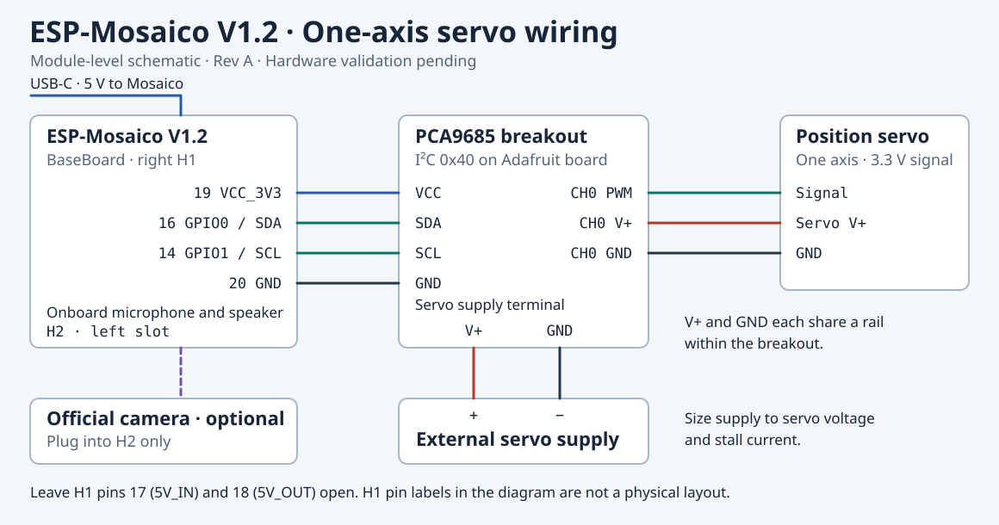

# ESP-Mosaico版 StackChan 試作設計

ESP-Mosaico CoreBoard V1.2の内蔵マイクとスピーカーで日本語会話を行い、画面に表情を出し、首を左右に振る。iPhoneが文字起こし、会話APIへの接続、読み上げ音声生成を担当する。この資料はモジュール間の配線を示す。ファームウェアとiPhoneアプリは設計段階で、配線の実機検証は未実施。

## 回路図

| 接続元 | 接続先 | 信号・電源 |
|---|---|---|
| Mosaico 右 H1 pin 19 | PCA9685 VCC | 3.3 Vロジック電源 |
| Mosaico 右 H1 pin 16 / GPIO0 | PCA9685 SDA | 外部I²C1データ |
| Mosaico 右 H1 pin 14 / GPIO1 | PCA9685 SCL | 外部I²C1クロック |
| Mosaico 右 H1 pin 20 | PCA9685 GND | 共通GND |
| サーボ外部電源 ＋ / − | PCA9685のサーボ電源端子 V+ / GND | 5 V対応サーボなら5 V |
| PCA9685 CH0 PWM / V+ / GND | サーボ 信号 / 電源＋ / 電源− | 位置指定型で3.3 V制御信号に対応するサーボを選ぶ |
| Mosaico 左 H2 | 公式カメラモジュール | 第2段階で追加 |

### 組み立てと確認

1. 電源を切って配線する。H1はH2に対して180度回転している。公式端子図で1番ピンとコネクターの向きを確認する。
2. MosaicoはUSB-Cから給電する。サーボ電源＋はPCA9685のV+だけに配線し、H1の17番 5V_IN と18番 5V_OUT は開放する。外部電源−とMosaicoのGNDはPCA9685のGNDで共通にする。VCCとV+は分離する。
3. BSPで外部電源レールを有効にし、H1 pin 19が約3.3 Vになることを確認する。PCA9685基板のSDA/SCLプルアップ先も3.3 Vとする。サーボを外した状態でI²C1上のPCA9685を確認する。Adafruit基板の既定アドレスは7ビットの0x40。外部電源はサーボの定格電圧と軸が拘束されたときの電流を基準に選ぶ。
4. サーボの仕様に従ってPWM周期とパルス幅を設定する。ホーンを外した状態で中心位置を確認してから機構を取り付け、狭い角度から可動範囲を調整する。
5. サーボ動作中に録音・再生し、再起動、音切れ、異音、機構との接触を確認する。H1の1、3、5、7、9番ピンは内蔵音声I²Sと共用なので、この構成では開放する。

## ファームウェアの方針

- ESP-IDF 6.2以降と公式Mosaico BSPを起点に、hmi_demoとaudio_loopbackで画面・タッチ・音声を個別に確認する。
- タッチで録音を開始し、Wi-FiでiPhoneに音声を渡す。返答音声をMosaicoで再生し、その音量に合わせて口を動かす。初号機のiPhoneアプリは前面で使用する。
- カメラ追加後は公式ai_model_galleryを土台に、画面内の顔の位置から首振りを制御する。文字認識は撮影操作でのみ実行し、iPhoneのApple Visionを使う。

## 公式資料

- [ESP-Mosaico V1.2 右H1の端子表](https://docs.espressif.com/projects/esp-dev-kits/en/latest/esp32s31/esp-mosaico/user_guide.html#right-module-slot-h1-pins)
- [ESP-Mosaico カメラモジュール](https://docs.espressif.com/projects/esp-dev-kits/en/latest/esp32s31/esp-mosaico/user_guide_camera.html)
- [ESP-Mosaico BSP・サンプル](https://github.com/esp-mosaico/esp-mosaico-bsp)
- [Adafruit PCA9685ブレークアウトの端子仕様](https://learn.adafruit.com/16-channel-pwm-servo-driver/pinouts)
- [NXP PCA9685データシート](https://www.nxp.com/docs/en/data-sheet/PCA9685.pdf)
